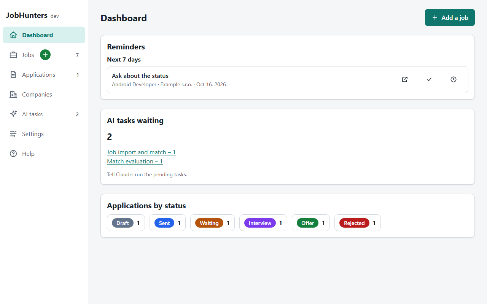
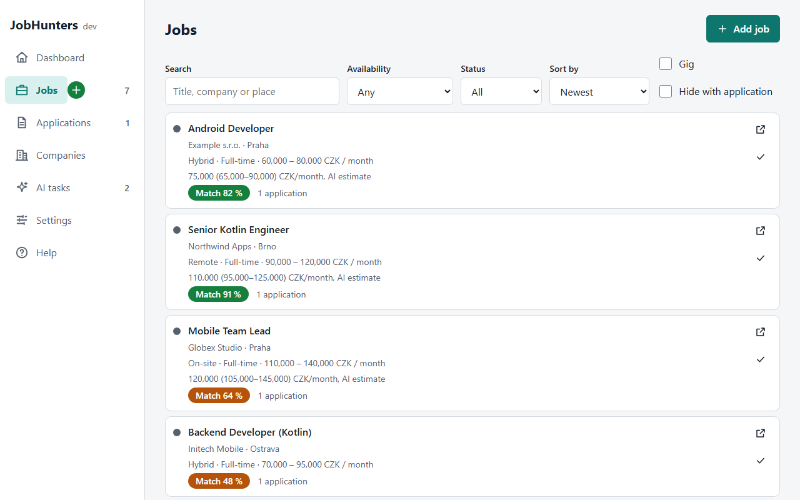
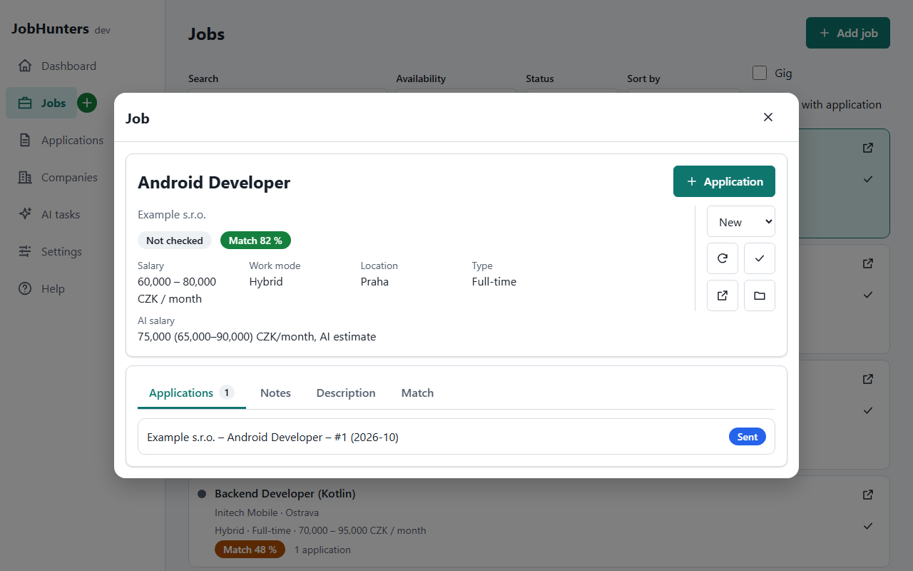
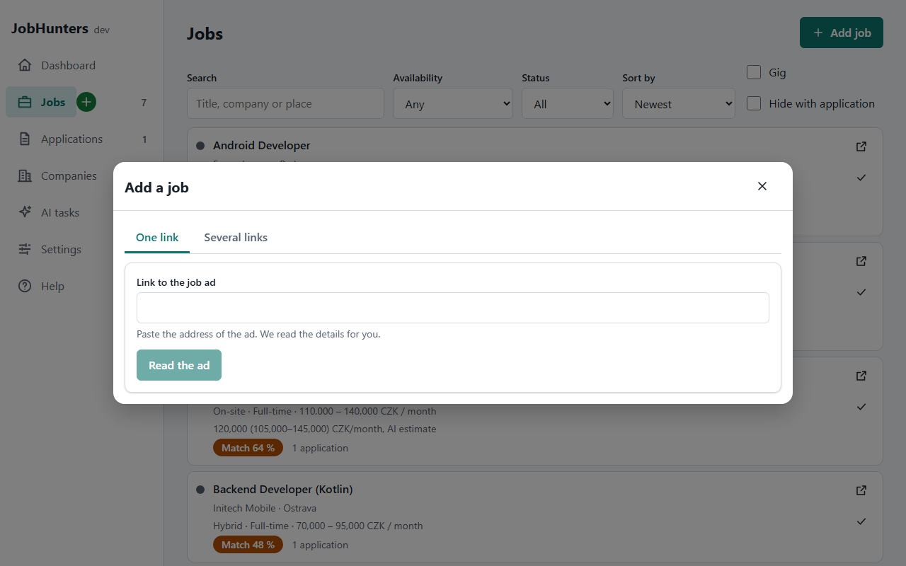
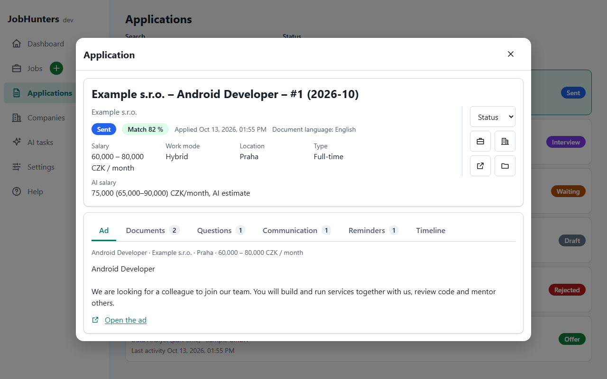
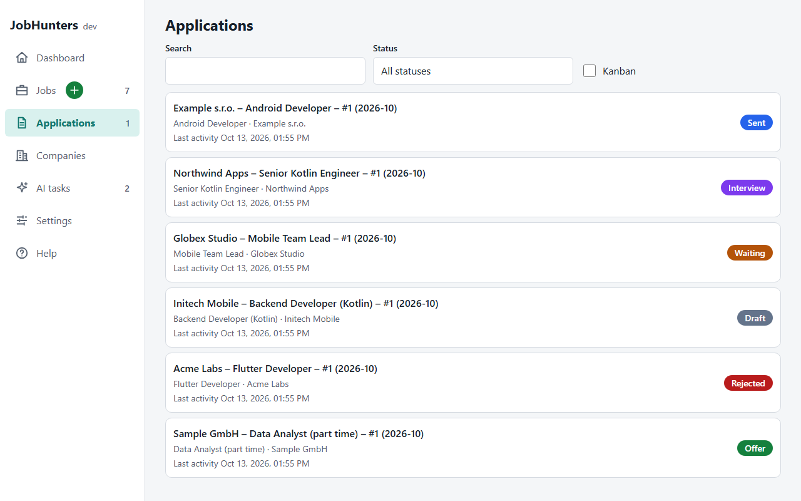
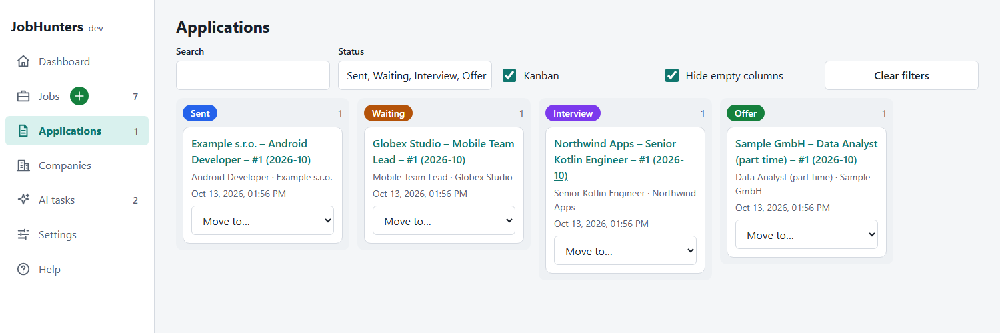
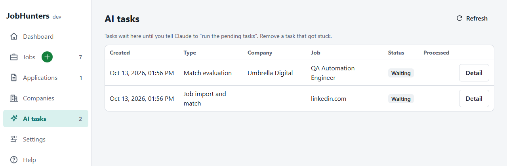
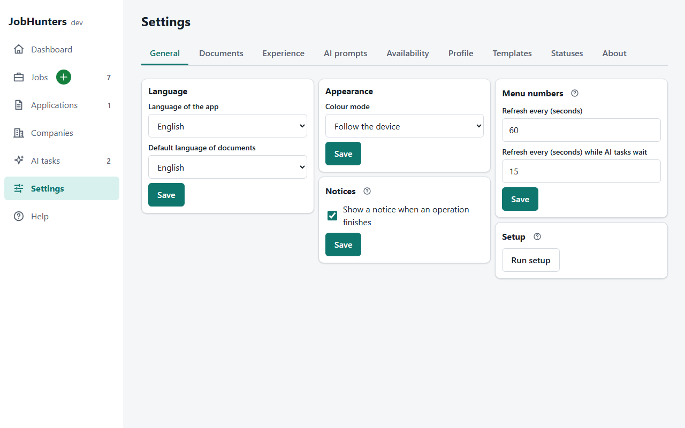

# JobHunters

A personal job-search manager that runs **for free on your own Google account**. It keeps your job ads, your
applications, the documents you send and everything that happens in between in one place, and it lets an AI assistant
do the writing and the reading for you.

- **No server, no subscription.** The backend and the web app are Google Apps Script, the data lives in a Google Sheet
  in your Drive, the documents are Google Docs.
- **Your data stays yours.** Nothing is sent to a service run by this project. You can open the spreadsheet any time
  and read or edit every row by hand.
- **The AI is optional.** Everything that does not need writing or judgement works without it. With it, the app helps
  with the match evaluation, the salary estimate, the resume and cover letter, and other documents such as an interview
  preparation. No API key and no particular AI vendor is needed (see
  [Working with the AI assistant](#working-with-the-ai-assistant)).
- **Works on a phone.** The web app is responsive; add it to the home screen.
- **English and Czech** interface.

<p align="center">
  
</p>

## Contents

- [What you can do with it](#what-you-can-do-with-it)
- [How it works](#how-it-works)
- [The screens](#the-screens)
- [Working with the AI assistant](#working-with-the-ai-assistant)
- [Your data](#your-data)
- [Privacy and safety](#privacy-and-safety)
- [Getting started](#getting-started)
- [Development](#development)
- [License](#license)

## What you can do with it

### Collect job ads

- **Add an ad by its link.** The app downloads the page, reads the title, company, location, salary, work mode
  (on-site, hybrid, remote), type of employment, dates and the full text, and shows you the result to check before it
  is saved. Dedicated readers exist for several portals (jobs.cz, StartupJobs, LinkedIn) and a generic reader works with
  any page that publishes the standard job-posting data.
- **Paste the text** when a page cannot be downloaded, or add **many links at once**, one per line.
- **Let the AI import it.** For ads the app cannot read (a portal that blocks scripts, a login wall) you can queue an AI
  task that reads the ad and fills in the job, optionally evaluating how well you match it in the same task.
- A **copy of every ad** (HTML or text) is stored in your Drive, so you still have it when the page disappears.
- **Duplicates are recognised**: the same ad opened through different links is found and not saved twice.
- **Refresh an ad** to read it again without losing your notes, status or evaluation.
- **Check whether an ad is still online** with one click, or let the app do it by itself every day at hours you choose.
  The rules (a "gone" page, a redirect, an expiry date, phrases such as "position has been filled") are yours to edit.

### Evaluate and filter

- **Match evaluation by AI**: a percentage, the strengths, the gaps and a verdict, based only on the experience you
  wrote down. The percentage is shown as a coloured badge (suitable, partly, not suitable).
- **AI salary estimate**: what to ask for and the realistic range, shown next to the salary of the ad.
- **Ad statuses that follow your work**: New, Applied (when you create an application) and Archived (when an application
  is rejected), plus your own ad statuses with names and colours, flags for gigs (with the shift) and part-time work, notes, the contact person of an
  ad, and a reason why not when you set a job to No.
- Search, filters (availability, status, gig, jobs that already have an application, jobs set to No), sorting by date or match, and a
  **Clear filters** button. The choices are remembered.

### Apply

- **The salary you ask for** can be typed when you create an application and is shown next to the AI salary in its
  detail; a double-click changes it.
- **Applications are created from your templates.** Keep your resume and cover letter as Google Docs with
  placeholders such as `{{name}}`, `{{company}}`, `{{position}}`, `{{date}}`, `{{links}}` and `{{body}}`. A new
  application copies them into its own folder and fills in what it knows.
- **The AI writes the content** (the `{{body}}`, the whole document, or the answers to application questions) from your
  experience and the text of the ad, in the language of the ad. You can edit the result in Google Docs.
- **Any other document, too.** A template of the type *Other* describes what the document must contain, for example an
  interview preparation for this company and position, and the AI fills it in from the ad and your experience.
- **Preview, open in Google Docs, export to PDF.** PDFs are named after you, the document type, the company and the
  position, and the app tells you when a document changed since its last export. Exporting again replaces the same PDF
  in the application's folder, and one click on "Download PDF" saves it to your computer
  (Drive downloads it into the current window, no tab of its own).
- **Questions of the application** with an answer limit in sentences, answered by the AI or by you.
- **Prepare with AI** in one step: create the application and queue the AI tasks for its documents.

### Follow up

- **Statuses** (draft, sent, waiting, interview, offer, rejected, ghosted, withdrawn) with your own names and colours,
  and a table of **which changes are allowed**. Moving to "Waiting" asks for a reminder date.
- A **Kanban board** with drag and drop, or a list with filters; both can be sorted by match score, date created, salary, date sent and days waiting.
- **Communication log** (messages, meetings, homework and confirmations over e-mail, phone, video call, LinkedIn, in person or a
  portal), **reminders** with a Dashboard of what is
  overdue and what is coming, and a **timeline** of everything that happened to an application.
- **Companies** with their website, notes, jobs and applications.
- **Calendar**: the whole month with your interviews (chips on their day) and the applications you are waiting for (bars from the day they went to Waiting to the day of the reminder, red once it has passed); the arrows move a month, and the colors of the entries can be chosen in Settings.
- **Emails**: a read-only viewer of the mail that a separate script copies from your mailbox into the sheet Emails (search, direction filter, bulk mail hidden on request).

The record of what happened and when is the core of this part: every status change, message, reminder and document
stays in the timeline of the application, so you are prepared for the next step and for the interview.

### Make it yours

- **Profile** (name, e-mail, phone, address, portfolio, LinkedIn, GitHub, website) used in your documents.
- **Experience**: free text about your work, skills and goals. It is the only source of facts the AI may use.
- **History of your texts**: every saved change of your experience, of each AI prompt and of the texts that mean an ad
  is gone is kept as a version (resetting the prompts to the defaults is kept too, so your own prompts can always come back). A version can have a comment
  and a pin, and *Use This* restores it as a new version, so nothing is lost. A *Changes* tab compares a version with the
  current text: what disappears is red, what appears is green, and inside a changed line only the changed words are
  marked. The number of unpinned versions kept is a setting (default 50).
- **AI prompts**: the full text of every AI task is editable, each on its own tab, with a button to go back to the
  defaults. The app tells you when the built-in prompts changed in a new version.
- **Settings with built-in explanations**: a "?" next to a setting says what it does and which values are allowed.
- Interface language, light or dark mode, which numbers the menu shows (for example new jobs with no application, or
  two numbers as "first / second") and how often they refresh, time zone of the script.

## How it works

```
 your browser / phone ──► Apps Script web app ──► Google Sheet  (all data, one tab per kind of record)
                                │                 Google Drive  (folders, ad copies, PDFs)
                                └──────────────►  Google Docs   (templates and documents)

 AI assistant (any agent that can edit your Sheet) ──► reads the queued tasks, writes the results back
```

- The **web app** is one page served by Apps Script. It talks to a small API in the same script.
- The **spreadsheet is the database.** Each kind of record has its own tab (Companies, Jobs, Applications, Documents,
  Questions, Communications, Reminders, Tasks, Templates, Profile, Settings, StatusHistory, Log and a few more). Row 1 of
  every tab names the columns. You may reorder columns or add your own: the app finds columns by name and keeps the ones
  it does not know.
- **Text is never executed.** Cells are stored as text, so something like `=1+1` in a notes cell stays text.
- A **time trigger** runs every hour and starts the scheduled availability check at the hours you picked.
- The business logic lives in a package that knows nothing about Google, so it is fully covered by automated tests.

## The screens

### Jobs

Every ad as a card: the company, place, Remote / Hybrid, type, salary, the AI salary estimate, the match badge and how many
applications you have. A narrow column of icons opens the original ad and checks its availability, and two checkboxes
ask the AI for a match or prepare an application in one click.

<p align="center">
  
</p>

The detail of a job shows the facts of the ad on the left, with the checkboxes Remote and Hybrid that you can tick at any
time, and the status with the actions on the right (refresh the ad, check availability, open the ad, open its folder in
Drive, delete a job that has no application). Its tabs hold the applications, your notes, the saved
description and the AI evaluation.

<p align="center">
  
</p>

### Adding a job

<p align="center">
  
</p>

Paste a link and check what the app found. Above "Save job" you can already ask the AI to evaluate the match or to
create the resume and the cover letter. When a page cannot be downloaded, or the app finds only a title, you paste
its text, or tick "Create AI job to import" (always shown under the link) and let the AI read the ad and evaluate the
match in one task. You can add extra instructions for the AI there.

### Applications

<p align="center">
  
</p>

An application has the same layout as a job: the facts, the Remote and Hybrid checkboxes and the match on the left, the status control and the shortcuts
(job, company, ad, folder) on the right. The tabs are the saved text of the ad, the documents, the questions, the
communication, the reminders and the timeline.

<p align="center">
  
</p>

The same applications as a Kanban board: drag a card to another column to change its status, or use the menu of the
card on a touch screen. Only the changes allowed in Settings are possible.

<p align="center">
  
</p>

### AI tasks

<p align="center">
  
</p>

Everything you ask the AI for becomes a task in a queue. You see what waits, what is running, what is done, what needs
your answer and what failed, together with the result.

### Settings

<p align="center">
  
</p>

Tabs for the general options, the documents, your experience, the AI prompts, the availability check, your profile, the
templates and the statuses. A red exclamation mark by Settings means something needs you (for example "run setup" after
an update, or "the built-in prompts changed").

## Working with the AI assistant

The AI is optional, and the app does not call one by itself: it needs no API key and is tied to no vendor. It writes **tasks** into your spreadsheet, and an AI assistant that can edit your
Sheet, Drive and Docs (for example Claude with the Google connectors) carries them out when you ask it to:

1. In the app you ask for something: a match evaluation, the content of a document, an answer to a question, the import
   of an ad. A task appears in the queue and the menu shows how many are waiting.
2. You tell the assistant: **"run the pending tasks"**. Each task contains a complete instruction: which sheet and row
   to read, what to write and where, and what to do when it cannot finish (ask a question, report a failure).
3. The assistant writes the result into the spreadsheet or the document and marks the task done. Reload the app and
   you see it.

Good to know:

- It has been tried with **Claude.ai** and **Google AI Studio**. Any assistant that can read and edit your Sheet, Drive
  and Docs and follow numbered instructions should do.
- The instructions are **prompts you can read and edit** (Settings → AI prompts). They are written to work with any
  capable assistant, with numbered steps and exact cell names.
- The AI is told to use **only the facts from your experience text** and to leave out what it does not know.
- The text of ads is treated as **untrusted**: the prompts say never to follow instructions found inside an ad.
- For ads on portals that block automatic readers, the import prompt tells the assistant to read the single page like a
  careful person, to try your own already signed-in browser at most once if it has a tool for that, and to stop at the
  first obstacle (a captcha, a login demand, a warning) instead of getting around it.

## Your data

- Everything is in **one spreadsheet** named JobHunters in a **JobHunters folder** in your Drive. Under it the app keeps
  `Companies/<company>/<job>/` with the saved copy of the ad and, for each application, its folder with the documents
  and PDFs, plus the folders `Templates` and `Profile`.
- You can **look at the data and fix it by hand** in the spreadsheet. Rows the app cannot understand (an unknown status,
  a missing id, a repeated id) are reported as warnings and ignored, never silently changed.
- **Setup is safe to repeat.** It creates what is missing (the folder, the spreadsheet, the tabs, new columns after an
  update, the hourly trigger) and never overwrites your data. You run it from the Settings screen or from the editor.

## Privacy and safety

- The web app **runs as you** and is reachable only by you. The script has access only to what your Google account has.
- The personal values of an installation (the IDs of your script, spreadsheet and folder) are kept in the script
  properties of your Google project and in your own copy of `.clasp.json`, which is **never committed**.
- Pages are **downloaded by your script**, not by a third-party service. Nothing is sent to the author of this project.
- The preview of a document is shown in a **sandboxed frame** without scripts, and everything the interface prints is
  escaped, so a hostile ad or document cannot run code in your browser.
- Spreadsheet cells that look like formulas are written as literal text.

## Getting started

You need a Google account and Node.js 22.12 or newer.

```bash
npm install
npm run build
```

Then, in short (the complete steps are in [docs/deploy.md](docs/deploy.md)):

1. Create an Apps Script project, copy `.clasp.json.example` to `.clasp.json` and put your own script ID into it.
2. `npx clasp login`, then `npx clasp push`.
3. In the Apps Script editor run `setup` once and grant the permissions. It creates the folder, the spreadsheet and the
   hourly trigger.
4. Deploy the project as a **web app** (execute as you, access only you) and open its address.
5. In **Settings** fill in your profile, your experience and the addresses of your Google Docs templates, then add your
   first job.

After every update of the app: `npm run build`, `npx clasp push`, deploy a new version of the web app, open Settings and
press **Run setup** if the red mark asks for it.

## Development

```bash
npm install
npm run typecheck      # TypeScript and Svelte checks
npm test               # the whole test suite
npm run build          # writes dist/ for clasp
npm run dev -w @jobhunters/ui   # the interface against demo data in memory, no Google needed
```

The development page runs on fictional data held in memory (a reload resets it). Open it with `?demo` for a larger set
of fictional jobs and applications, which is what the screenshots in this document show.

Layout of the repository:

- `packages/core`: the domain logic in plain TypeScript, without any Google API. Parsers of job ads, the status rules,
  the placeholders of documents, the prompts and the settings.
- `packages/gas`: the Apps Script layer: the API, the adapters for Sheets, Drive, Docs and the triggers, setup, and a
  complete in-memory backend used by the tests and by the development page.
- `packages/ui`: the web app (Svelte 5, built into a single `ui.html`).

Technology: TypeScript, Svelte 5, Vite, esbuild, Vitest, `clasp`. The version of the app is `APP_VERSION` in
`packages/gas/src/Version.gs`; the history is in [CHANGELOG.md](CHANGELOG.md).

Never commit `.clasp.json`, `.clasprc.json` or `.env`.

## License

MIT, see [LICENSE](LICENSE).
